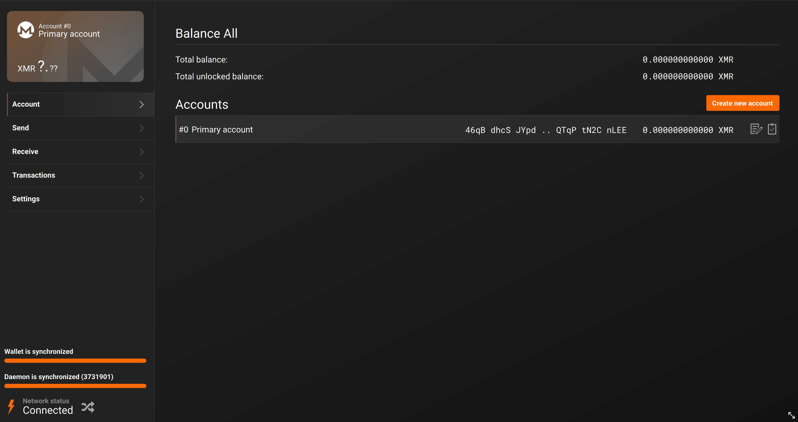
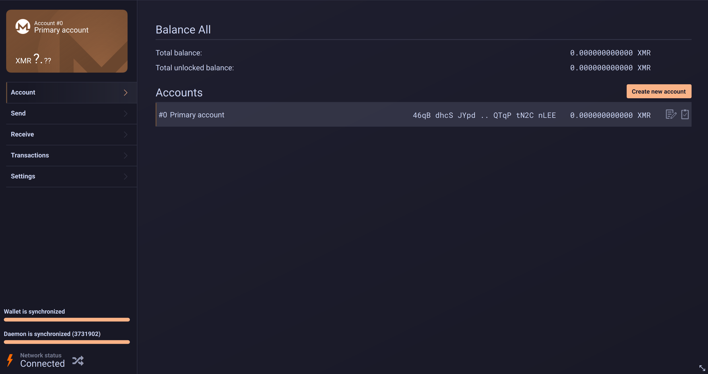
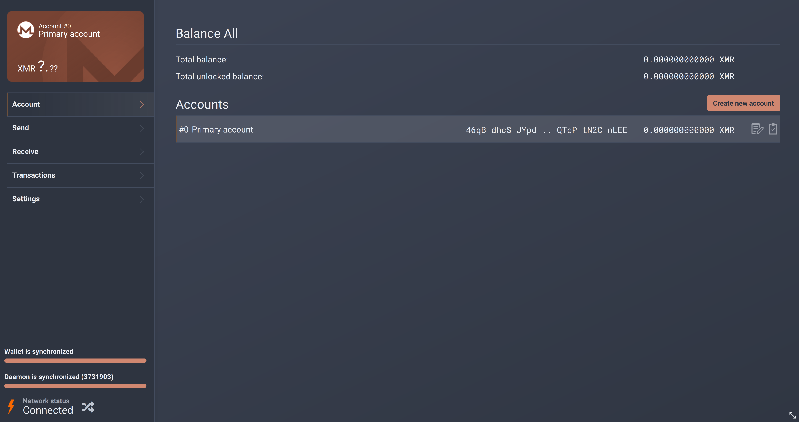
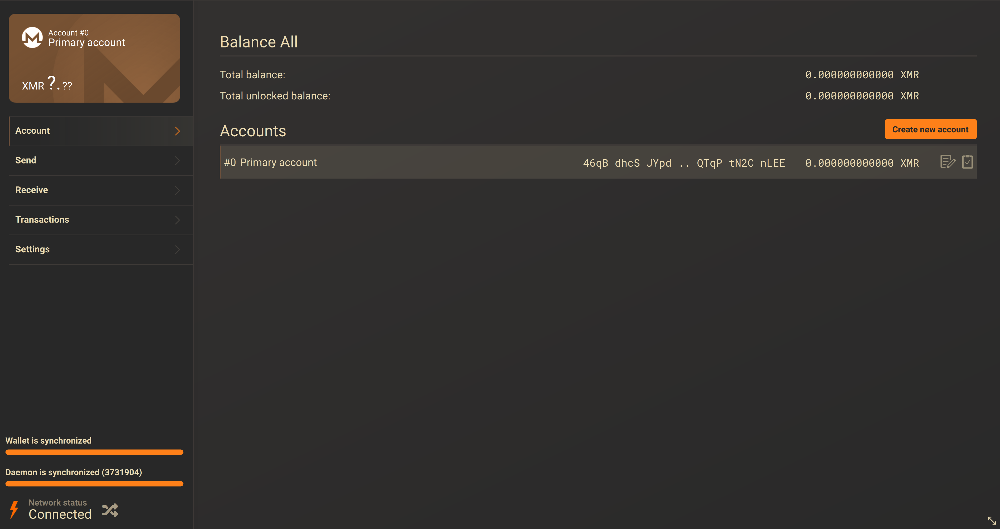
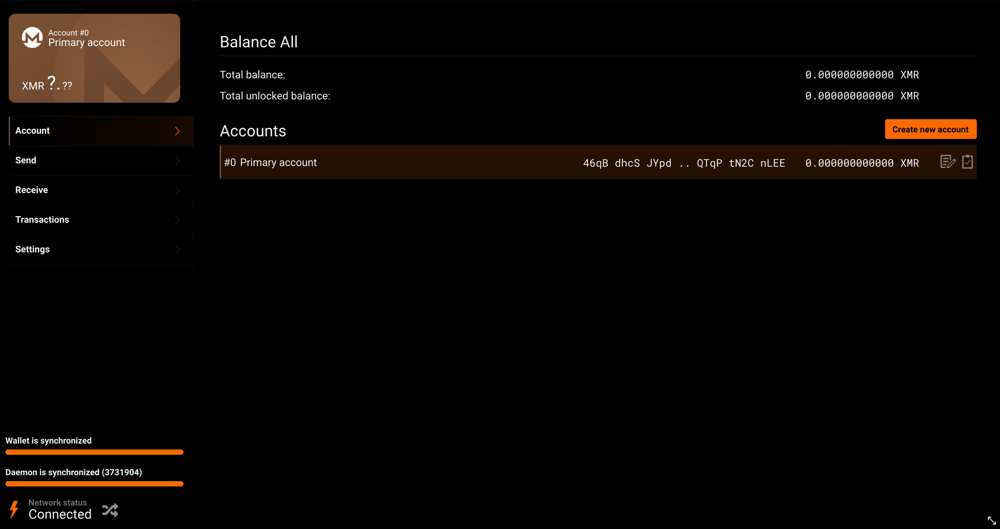
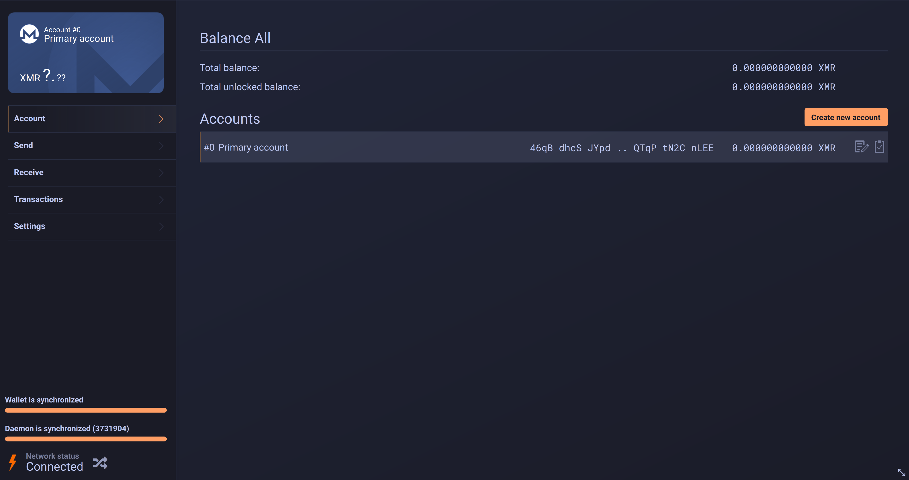
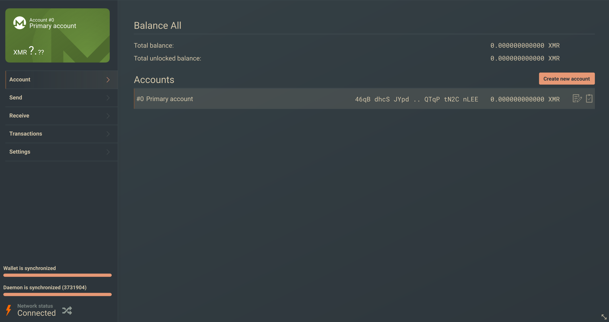
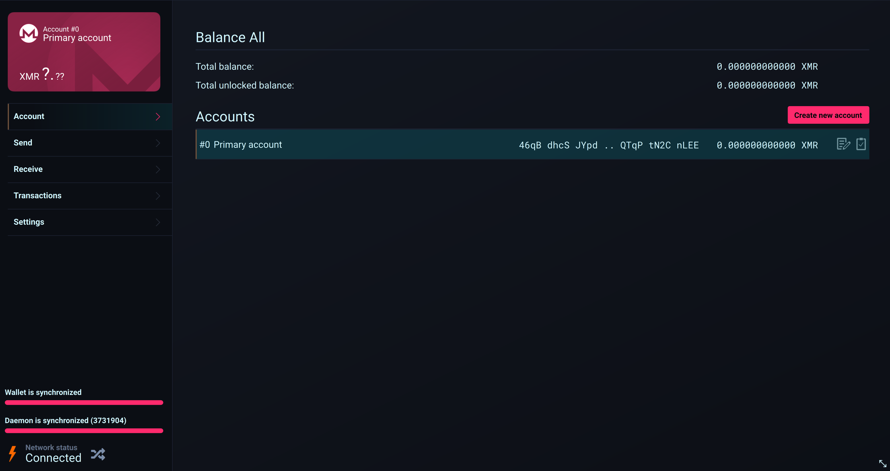
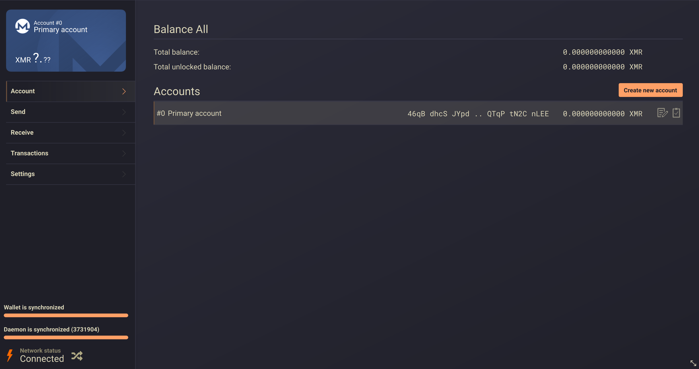
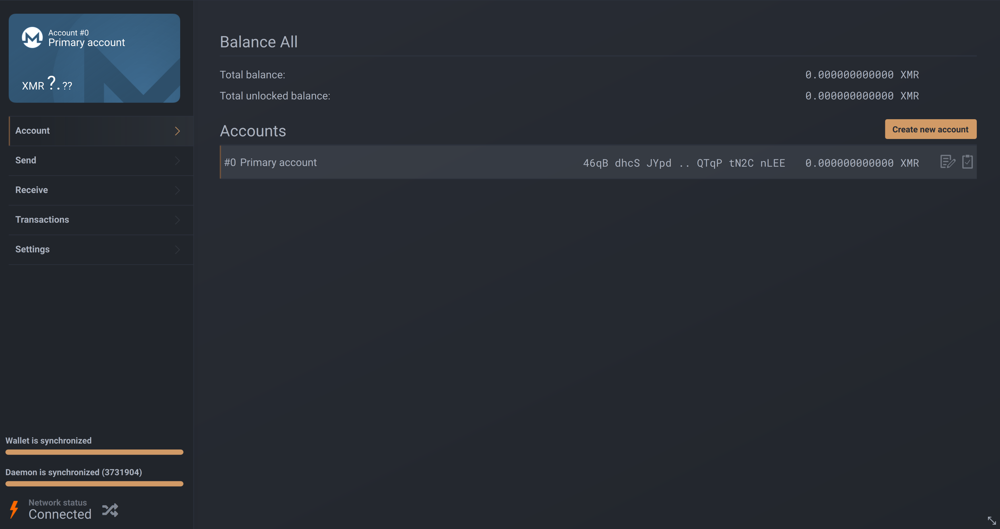

# Palettes

A local experiment on top of the System/Light/Dark selector from
[#4670](https://github.com/monero-project/monero-gui/pull/4670). Not proposed for
upstream.

Palette and mode are independent. `Style.theme` still decides system/light/dark,
and `Style.palette` decides which colour set is used. Every palette ships both a
light and a dark variant, so "System" flips between them the same way it flips
Monero dark and light.

Set it in Settings, Interface, Palette.

## Screenshots

Dark variant of each palette.

### Monero

Stock upstream colours, unchanged.



### Catppuccin

Mocha for dark, Latte for light.



### Nord

Polar Night with the Aurora orange accent.



### Gruvbox



### OLED

True black for OLED panels, with a hot Monero orange accent. Dark only; its light
variant falls back to stock Monero light.



### Tokyo Night



### Everforest



### Cyberpunk

Not based on a published spec, unlike the others.



### Kanagawa

Wave for dark, Lotus for light.



### One Dark



## Adding a palette

Palettes live in `js/Palettes.js`. Add a ramp, register it in `all`, and list it in
`order`. Nothing else needs to change.

```js
var MY_PALETTE_DARK = {
    cardHue: 0.5,
    crust: "#000000", mantle: "#000000", base: "#000000",
    surface0: "#111111", surface1: "#222222", surface2: "#333333",
    overlay: "#666666", subtext: "#999999", subtextBright: "#cccccc", text: "#ffffff",
    accent: "#ff6a00", accentHover: "#ff8524", accentText: "#000000",
    error: "#ff4d4d", inputBgError: "#3d1414",
    hoverOverlay: "#20ffffff", menuOverlay: "#14ffffff", menuOverlayFaint: "#0fffffff",
    appWindowBackgroundColor: "white", textBold: true,
    accountColors: STOCK_ACCOUNT_COLORS
};
```

`variant()` expands that ramp into the full token set `Style.qml` consumes. The
`monero` palette is the exception: it is written out in full, because upstream's
greys are ad-hoc and do not fit a ramp. Spelling it out keeps the stock theme
pixel-identical.

## Notes

The account card artwork is a bitmap, so palettes hue-shift it with `Colorize`
rather than recolouring it. That preserves the gradient, the watermark and the
per-account variation. It applies to the dark variant when OpenGL is available;
other paths fall back to the stock artwork.

Account colour chips in Receive, Account and MenuButton still use the stock
array, because those indices map to the `card-background-black<N>.png` files.

Light variants for Tokyo Night, Kanagawa and Everforest are derived rather than
taken from a reference implementation, and Cyberpunk's light variant is invented
outright. They are the least polished part of this.
